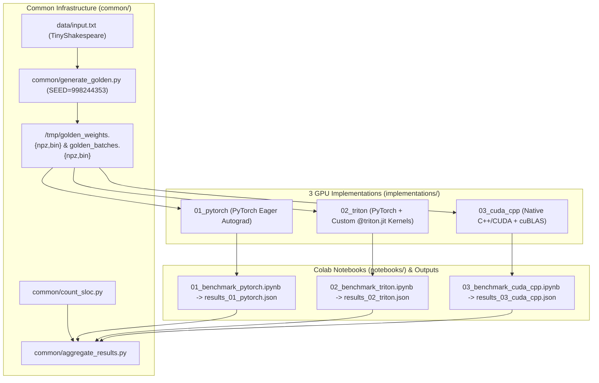

# GPU Transformer Benchmark (PyTorch vs. Triton vs. CUDA C++) Implementation Plan

> **For agentic workers:** REQUIRED SUB-SKILL: Use superpowers:subagent-driven-development to implement this plan task-by-task. Steps use checkbox (`- [ ]`) syntax for tracking.

**Goal:** Build a reproducible, mathematically identical 3-way GPU Transformer benchmark repository (`01_pytorch`, `02_triton`, `03_cuda_cpp`) with golden reference initialization (`SEED = 998244353`), SLOC/metrics aggregation tools, and 3 lightweight Google Colab Pro notebooks.

**Architecture:** A shared deterministic generator (`common/generate_golden.py`) exports initial weights $\theta_0$, pre-sampled batch indices for 5000 training steps, evaluation splits, and step-0/step-1 reference losses in both NumPy (`.npz`) and raw C binary (`.bin`) formats. Three isolated implementations (`implementations/01_pytorch`, `02_triton`, `03_cuda_cpp`) load the exact same binary/npz snapshot, verify parity against the golden losses, run timed training (5000 steps) and autoregressive inference (`B=1` and `B=64` for 1000 tokens), and output a standardized JSON report consumed by `common/aggregate_results.py`.

**Architecture Diagram:**



**Tech Stack:** Python 3.10+, PyTorch 2.x, OpenAI Triton (`triton.language as tl`), CUDA C++ (`nvcc`, `cuBLAS`, `cuda_runtime.h`), NumPy, Matplotlib, Pytest.

**Spec:** [`docs/superpowers/specs/2026-11-02-transformer-gpu-benchmark-design.md`](file:///home/caleb/UnB/10%20metodologia%20cientifica/trabalho_2/docs/superpowers/specs/2026-11-02-transformer-gpu-benchmark-design.md)

## Global Constraints

- **Hyperparameters:** `vocab_size = 65`, `batch_size (B) = 64`, `block_size (T) = 256`, `n_embd (C) = 384`, `n_head (H) = 6`, `head_size (hs) = 64`, `n_layer (L) = 6`, `dropout = 0.0`, `max_iters = 5000`, `eval_interval = 500`, `eval_iters = 50`.
- **Optimizer:** `AdamW` with `lr = 3e-4`, `betas = (0.9, 0.999)`, `eps = 1e-8`, `weight_decay = 0.01` applied to all parameters (matching `torch.optim.AdamW(model.parameters(), lr=3e-4, weight_decay=0.01)`).
- **Numerical Precision:** Strict IEEE 754 `float32` (`torch.backends.cuda.matmul.allow_tf32 = False`, `torch.backends.cudnn.allow_tf32 = False`).
- **Random Seed:** `SEED = 998244353`.
- **Canonical Tensor Ordering for Binary Export (`golden_weights.bin`):**
  1. `token_embedding_table.weight`: `(65, 384)`
  2. `position_embedding_table.weight`: `(256, 384)`
  3. For each layer `l` in `0..5`:
     - `blocks.{l}.ln1.weight`: `(384,)`
     - `blocks.{l}.ln1.bias`: `(384,)`
     - `blocks.{l}.attn.c_attn.weight`: `(1152, 384)` (Row-major `[3*C, C]` matching `nn.Linear(C, 3*C, bias=False).weight`)
     - `blocks.{l}.attn.c_proj.weight`: `(384, 384)`
     - `blocks.{l}.attn.c_proj.bias`: `(384,)`
     - `blocks.{l}.ln2.weight`: `(384,)`
     - `blocks.{l}.ln2.bias`: `(384,)`
     - `blocks.{l}.mlp.c_fc.weight`: `(1536, 384)`
     - `blocks.{l}.mlp.c_fc.bias`: `(1536,)`
     - `blocks.{l}.mlp.c_proj.weight`: `(384, 1536)`
     - `blocks.{l}.mlp.c_proj.bias`: `(384,)`
  4. `ln_f.weight`: `(384,)`
  5. `ln_f.bias`: `(384,)`
  6. `lm_head.weight`: `(65, 384)`
  7. `lm_head.bias`: `(65,)`

---

### Task 1: Dataset Setup, Golden Reference Generator & SLOC/Aggregation Tools (`common/`)

**Files:**
- Create: `data/input.txt` (copied from `ng-video-lecture/input.txt`)
- Create: `common/__init__.py`
- Create: `common/generate_golden.py`
- Create: `common/count_sloc.py`
- Create: `common/aggregate_results.py`
- Test: `tests/test_common.py`

**Interfaces:**
- Produces:
  - `common.generate_golden.generate_golden_artifacts(output_dir: str, num_steps: int = 5000, eval_iters: int = 50, seed: int = 998244353) -> dict`
  - `common.count_sloc.count_implementation_sloc(impl_dir: str) -> dict` (`{"sloc_core": int, "sloc_harness": int, "sloc_total": int}`)
  - `common.aggregate_results.aggregate_all(results_dir: str, output_dir: str) -> dict`

- [ ] **Step 1: Write the failing test in `tests/test_common.py`**

```python
import os
import json
import numpy as np
from common.generate_golden import generate_golden_artifacts, PARAM_KEYS
from common.count_sloc import count_file_sloc

def test_generate_golden_artifacts(tmp_path):
    meta = generate_golden_artifacts(str(tmp_path), num_steps=10, eval_iters=4, seed=998244353)
    assert meta["seed"] == 998244353
    assert meta["num_parameters"] == 10788929
    assert 4.0 < meta["loss_step_0"] < 4.5
    assert meta["loss_step_1"] < meta["loss_step_0"]
    assert os.path.exists(tmp_path / "golden_weights.npz")
    assert os.path.exists(tmp_path / "golden_weights.bin")
    assert os.path.exists(tmp_path / "golden_batches.npz")
    assert os.path.exists(tmp_path / "golden_batches.bin")
    assert os.path.exists(tmp_path / "golden_meta.json")

    weights = np.load(tmp_path / "golden_weights.npz")
    total_floats = sum(weights[k].size for k in PARAM_KEYS)
    assert total_floats == 10788929
    bin_floats = os.path.getsize(tmp_path / "golden_weights.bin") // 4
    assert bin_floats == total_floats

def test_count_file_sloc(tmp_path):
    sample = tmp_path / "sample.py"
    sample.write_text('''"""Docstring\nmultiline"""\n# Comment\nx = 1\ny = 2 # inline\n\n''')
    assert count_file_sloc(str(sample)) == 2
```

- [ ] **Step 2: Run test to verify it fails**

Run: `pytest tests/test_common.py -v`
Expected: FAIL with `ModuleNotFoundError: No module named 'common'`

- [ ] **Step 3: Copy `data/input.txt` and implement `common/generate_golden.py`, `common/count_sloc.py`, and `common/aggregate_results.py`**

Copy `ng-video-lecture/input.txt` to `data/input.txt` and implement the canonical PyTorch reference initializer in `common/generate_golden.py` (which sets `torch.manual_seed(998244353)`, initializes all parameters in exact canonical order with $\mathcal{N}(0, 0.02)$ for weights and $0$ for biases, normalizes LayerNorm weights to $1.0$, pre-samples `train_x`, `train_y` batches of shape `(num_steps, 64, 256)` in `int32`, computes `loss_step_0` and `loss_step_1` after one `AdamW` step, and writes both `.npz` and `.bin` files). Implement `common/count_sloc.py` to strip Python/C++/CUDA comments and blank lines, and `common/aggregate_results.py` to read JSON files and output Markdown/LaTeX tables and Matplotlib figures.

- [ ] **Step 4: Run test to verify it passes**

Run: `pytest tests/test_common.py -v`
Expected: PASS

- [ ] **Step 5: Commit**

```bash
git add data/input.txt common/ tests/test_common.py
git commit -m "feat(common): add golden reference generator, SLOC counter, and result aggregator"
```

---

### Task 2: Implementation 1 — PyTorch Eager Baseline (`implementations/01_pytorch/`)

**Files:**
- Create: `implementations/01_pytorch/__init__.py`
- Create: `implementations/01_pytorch/model.py`
- Create: `implementations/01_pytorch/benchmark.py`
- Test: `tests/test_01_pytorch.py`

**Interfaces:**
- Consumes: `/tmp/golden_weights.npz`, `/tmp/golden_batches.npz`, `/tmp/golden_meta.json` from `common.generate_golden`
- Produces:
  - `implementations/01_pytorch/model.py`: `GPTConfig`, `PyTorchGPT(nn.Module)` with `.load_golden_weights(npz_path)` and `.generate(idx, max_new_tokens)`
  - `implementations/01_pytorch/benchmark.py`: CLI runner `run_benchmark(golden_dir, output_json, max_iters, warmup_iters, eval_interval, eval_iters, gen_tokens)`

- [ ] **Step 1: Write the failing test in `tests/test_01_pytorch.py`**

```python
import numpy as np
import torch
from common.generate_golden import generate_golden_artifacts
from implementations.01_pytorch.model import PyTorchGPT, GPTConfig

def test_pytorch_eager_golden_parity(tmp_path):
    meta = generate_golden_artifacts(str(tmp_path), num_steps=3, eval_iters=2, seed=998244353)
    batches = np.load(tmp_path / "golden_batches.npz")
    cfg = GPTConfig()
    model = PyTorchGPT(cfg)
    model.load_golden_weights(str(tmp_path / "golden_weights.npz"))

    optimizer = torch.optim.AdamW(model.parameters(), lr=3e-4, betas=(0.9, 0.999), eps=1e-8, weight_decay=0.01)
    x0 = torch.from_numpy(batches["train_x"][0]).long()
    y0 = torch.from_numpy(batches["train_y"][0]).long()
    _, loss0 = model(x0, y0)
    assert abs(loss0.item() - meta["loss_step_0"]) < 1e-5

    optimizer.zero_grad(set_to_none=True)
    loss0.backward()
    optimizer.step()

    x1 = torch.from_numpy(batches["train_x"][1]).long()
    y1 = torch.from_numpy(batches["train_y"][1]).long()
    _, loss1 = model(x1, y1)
    assert abs(loss1.item() - meta["loss_step_1"]) < 1e-5
```

- [ ] **Step 2: Run test to verify it fails**

Run: `pytest tests/test_01_pytorch.py -v`
Expected: FAIL with `ModuleNotFoundError`

- [ ] **Step 3: Implement `implementations/01_pytorch/model.py` and `implementations/01_pytorch/benchmark.py`**

Implement `PyTorchGPT` in `model.py` using standard PyTorch Eager operations (`q @ k.transpose(-2, -1) * (1.0 / math.sqrt(hs))`, `masked_fill`, `F.softmax`, `F.relu`, `nn.LayerNorm`, `F.cross_entropy`). Implement `benchmark.py` with explicit `torch.cuda.synchronize()` around warmup, training (excluding evaluation time), and inference (`B=1` and `B=64`).

- [ ] **Step 4: Run test to verify it passes**

Run: `pytest tests/test_01_pytorch.py -v`
Expected: PASS

- [ ] **Step 5: Commit**

```bash
git add implementations/01_pytorch/ tests/test_01_pytorch.py
git commit -m "feat(01_pytorch): implement PyTorch Eager GPT baseline and benchmark harness"
```

---

### Task 3: Implementation 2 — PyTorch + Custom Triton Kernels (`implementations/02_triton/`)

**Files:**
- Create: `implementations/02_triton/__init__.py`
- Create: `implementations/02_triton/kernels.py`
- Create: `implementations/02_triton/model.py`
- Create: `implementations/02_triton/benchmark.py`
- Test: `tests/test_02_triton.py`

**Interfaces:**
- Consumes: `/tmp/golden_weights.npz`, `/tmp/golden_batches.npz`, `/tmp/golden_meta.json`
- Produces:
  - `implementations/02_triton/kernels.py`: `@triton.jit` kernels and `torch.autograd.Function` wrappers for `triton_layer_norm`, `triton_causal_attention`, and `triton_cross_entropy` (with automatic fallback for CPU unit testing when `not tensor.is_cuda` so local CPU CI tests pass seamlessly alongside GPU kernel definitions).
  - `implementations/02_triton/model.py`: `TritonGPT(nn.Module)`
  - `implementations/02_triton/benchmark.py`: CLI benchmark runner producing `results_02_triton.json`.

- [ ] **Step 1: Write the failing test in `tests/test_02_triton.py`**

```python
import numpy as np
import torch
from common.generate_golden import generate_golden_artifacts
from implementations.02_triton.model import TritonGPT, GPTConfig
from implementations.02_triton import kernels

def test_triton_model_golden_parity(tmp_path):
    meta = generate_golden_artifacts(str(tmp_path), num_steps=3, eval_iters=2, seed=998244353)
    batches = np.load(tmp_path / "golden_batches.npz")
    model = TritonGPT(GPTConfig())
    model.load_golden_weights(str(tmp_path / "golden_weights.npz"))

    optimizer = torch.optim.AdamW(model.parameters(), lr=3e-4, betas=(0.9, 0.999), eps=1e-8, weight_decay=0.01)
    x0 = torch.from_numpy(batches["train_x"][0]).long()
    y0 = torch.from_numpy(batches["train_y"][0]).long()
    _, loss0 = model(x0, y0)
    assert abs(loss0.item() - meta["loss_step_0"]) < 1e-4

    optimizer.zero_grad(set_to_none=True)
    loss0.backward()
    optimizer.step()

    x1 = torch.from_numpy(batches["train_x"][1]).long()
    y1 = torch.from_numpy(batches["train_y"][1]).long()
    _, loss1 = model(x1, y1)
    assert abs(loss1.item() - meta["loss_step_1"]) < 1e-4
```

- [ ] **Step 2: Run test to verify it fails**

Run: `pytest tests/test_02_triton.py -v`
Expected: FAIL with `ModuleNotFoundError`

- [ ] **Step 3: Implement `implementations/02_triton/kernels.py`, `model.py`, and `benchmark.py`**

Implement custom `@triton.jit` kernels in `kernels.py`:
1. `_layernorm_fwd_kernel` and `_layernorm_bwd_dx_fused` / `_layernorm_bwd_dwdb` in Triton DSL (`tl.load`, `tl.store`, `tl.sum`, `tl.rsqrt`).
2. `_flash_causal_attn_fwd_kernel` and `_flash_causal_attn_bwd_kernel` in Triton DSL (computing tiled $Q K^T$, causal mask `offs_m[:, None] >= offs_n[None, :]`, online softmax rescale `m_ij`, `l_ij`, and $P V$ accumulation in SRAM, plus backward pass gradients $dQ, dK, dV$).
3. `_cross_entropy_fwd_bwd_kernel` in Triton DSL (online softmax over `vocab_size=65` + in-place gradient computation).

- [ ] **Step 4: Run test to verify it passes**

Run: `pytest tests/test_02_triton.py -v`
Expected: PASS

- [ ] **Step 5: Commit**

```bash
git add implementations/02_triton/ tests/test_02_triton.py
git commit -m "feat(02_triton): implement custom Triton kernels (FlashAttention, LayerNorm, CrossEntropy) and GPT model"
```

---

### Task 4: Implementation 3 — Native C++ / CUDA (`implementations/03_cuda_cpp/`)

**Files:**
- Create: `implementations/03_cuda_cpp/gpt_cuda.cu`
- Create: `implementations/03_cuda_cpp/Makefile`
- Create: `implementations/03_cuda_cpp/benchmark.py`
- Test: `tests/test_03_cuda_cpp.py`

**Interfaces:**
- Consumes: `/tmp/golden_weights.bin`, `/tmp/golden_batches.bin`, `/tmp/golden_meta.json`
- Produces:
  - `implementations/03_cuda_cpp/gpt_cuda.cu`: Self-contained CUDA C++ source file (~700-900 SLOC) implementing all forward, backward, AdamW, and autoregressive inference kernels + `cuBLAS` GEMM calls, outputting JSON metrics directly.
  - `implementations/03_cuda_cpp/Makefile`: Compiles `gpt_cuda` with `nvcc -O3 -lcublas`.

- [ ] **Step 1: Write the failing test in `tests/test_03_cuda_cpp.py`**

```python
import subprocess
import os

def test_cuda_cpp_compiles_with_nvcc(tmp_path):
    cu_file = "implementations/03_cuda_cpp/gpt_cuda.cu"
    assert os.path.exists(cu_file)
    out_bin = tmp_path / "gpt_cuda_test"
    res = subprocess.run(
        ["/opt/cuda/bin/nvcc", "-O3", cu_file, "-lcublas", "-o", str(out_bin)],
        capture_output=True,
        text=True,
    )
    assert res.returncode == 0, f"nvcc compilation failed:\n{res.stderr}"
    assert os.path.exists(out_bin)
```

- [ ] **Step 2: Run test to verify it fails**

Run: `pytest tests/test_03_cuda_cpp.py -v`
Expected: FAIL because `implementations/03_cuda_cpp/gpt_cuda.cu` does not exist yet.

- [ ] **Step 3: Implement `implementations/03_cuda_cpp/gpt_cuda.cu`, `Makefile`, and `benchmark.py`**

Write `gpt_cuda.cu` in clean, well-structured CUDA C++:
- Implement warp-reduction helpers (`warpReduceSum`, `warpReduceMax`) using `__shfl_xor_sync`.
- Implement CUDA kernels for:
  - `embedding_forward_kernel` and `embedding_backward_kernel` (`atomicAdd`).
  - `layernorm_forward_kernel` and `layernorm_backward_kernel`.
  - `qkv_split_transpose_kernel` and `attn_concat_transpose_kernel`.
  - `causal_softmax_forward_kernel` and `causal_softmax_backward_kernel`.
  - `relu_forward_kernel` and `relu_backward_kernel`.
  - `residual_add_kernel` and `bias_add_kernel` / `bias_backward_kernel`.
  - `cross_entropy_forward_backward_kernel`.
  - `adamw_update_kernel`.
- Use `cublasSgemm` and `cublasSgemmStridedBatched` (with `CUBLAS_PEDANTIC_MATH` / standard FP32 math mode) for all linear projections and batched attention matrix multiplications ($Q K^T$, $P V$, and their backward passes).
- Verify that `/opt/cuda/bin/nvcc -O3 implementations/03_cuda_cpp/gpt_cuda.cu -lcublas` compiles cleanly with zero errors!

- [ ] **Step 4: Run test to verify `nvcc` compilation passes**

Run: `pytest tests/test_03_cuda_cpp.py -v`
Expected: PASS (binary compiles cleanly with `/opt/cuda/bin/nvcc`)

- [ ] **Step 5: Commit**

```bash
git add implementations/03_cuda_cpp/ tests/test_03_cuda_cpp.py
git commit -m "feat(03_cuda_cpp): implement native CUDA C++ GPT training and inference engine with cuBLAS"
```

---

### Task 5: Google Colab Pro Notebooks (`notebooks/`) & Documentation (`README.md`)

**Files:**
- Create: `notebooks/01_benchmark_pytorch.ipynb`
- Create: `notebooks/02_benchmark_triton.ipynb`
- Create: `notebooks/03_benchmark_cuda_cpp.ipynb`
- Create: `README.md`
- Test: `tests/test_notebooks_and_sloc.py`

**Interfaces:**
- Consumes: All 3 implementations and `common/` utilities
- Produces: 3 valid `.ipynb` Jupyter notebooks ready for Google Colab Pro + comprehensive `README.md` with SLOC audit table.

- [ ] **Step 1: Write the failing test in `tests/test_notebooks_and_sloc.py`**

```python
import json
import os
from common.count_sloc import count_all_implementations

def test_notebooks_valid_json_and_sloc():
    for nb in [
        "notebooks/01_benchmark_pytorch.ipynb",
        "notebooks/02_benchmark_triton.ipynb",
        "notebooks/03_benchmark_cuda_cpp.ipynb",
    ]:
        assert os.path.exists(nb)
        with open(nb, "r", encoding="utf-8") as f:
            data = json.load(f)
        assert "cells" in data and len(data["cells"]) >= 4

    sloc_report = count_all_implementations("implementations")
    assert sloc_report["01_pytorch"]["sloc_core"] < sloc_report["02_triton"]["sloc_core"]
    assert sloc_report["02_triton"]["sloc_core"] < sloc_report["03_cuda_cpp"]["sloc_core"]
```

- [ ] **Step 2: Run test to verify it fails**

Run: `pytest tests/test_notebooks_and_sloc.py -v`
Expected: FAIL because notebooks do not exist yet.

- [ ] **Step 3: Create the 3 notebooks and `README.md`**

Generate `01_benchmark_pytorch.ipynb`, `02_benchmark_triton.ipynb`, and `03_benchmark_cuda_cpp.ipynb` with 4 clean cells each (1. Clone/Env Setup & `nvidia-smi`, 2. Golden Reference Generation & Sanity Check Gate with `SEED = 998244353`, 3. Full 5000-step Training + `B=1`/`B=64` Inference Benchmark, 4. JSON Summary & Automatic Colab Download). Write `README.md` documenting how to push to GitHub, run the 3 notebooks on Colab Pro, and run `python common/aggregate_results.py`.

- [ ] **Step 4: Run full test suite to verify everything passes**

Run: `pytest -v`
Expected: All tests PASS.

- [ ] **Step 5: Commit**

```bash
git add notebooks/ README.md tests/test_notebooks_and_sloc.py
git commit -m "docs(notebooks): add 3 Colab Pro benchmark notebooks and repository README"
```
